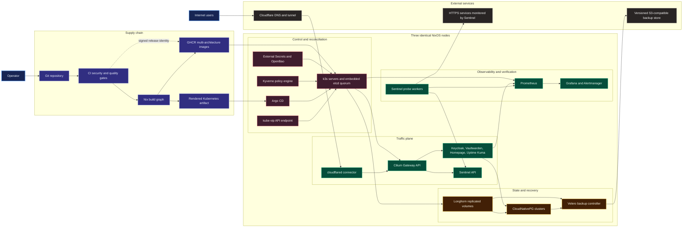

# Kubernetes Homelab, Rebuilt with Nix

[](https://github.com/AnouarMohamed/kubernetes-homelab-nix/actions/workflows/ci.yaml)
[](LICENSE)

A reproducible, security-conscious three-node k3s platform expressed as one
locked Nix flake. NixOS hosts, Kubernetes resources, policy, generated CI,
and the in-repo Sentinel service are evaluated together and shipped as an
auditable deployment artifact.

This repository is production-shaped, not a claim that somebody else's
hardware is production-ready. Builds, manifests, and policy are tested without
real credentials. Hardware failure, storage recovery, DNS, tunnels, and object
storage must be exercised in the target environment before serving real users.

## Why this repository is different

- **One locked graph:** operating systems, charts, CRDs, tools, Go modules,
  container bases, and actions are pinned.
- **No manifest pile:** typed Nix modules generate a single deterministic
  Kubernetes artifact; committed YAML is drift-checked output.
- **Secure defaults:** non-root SSH, CIDR-scoped control-plane access,
  digest-pinned workloads, namespace policy, Kyverno enforcement, and no
  committed credentials.
- **Supply-chain evidence:** Sentinel images are multi-architecture, include
  BuildKit provenance and SBOM attestations, and the release workflow applies
  keyless Sigstore signatures.
- **A real Go service:** Sentinel runs bounded concurrent probes, persists
  samples and transitions in PostgreSQL, exposes windowed SLO/error-budget
  analytics, emits Prometheus metrics and OpenTelemetry traces, and ships with
  race-tested unit and database integration suites.
- **Fail-closed integrity checks:** duplicate identities, absent namespaces,
  missing CRDs, floating images, version skew, leaked build artifacts, and
  broken GitOps paths fail validation.
- **Honest operations:** recovery targets and known exceptions are documented;
  unexecuted hardware or cloud checks are explicitly marked unverified.

## Architecture



Nix owns the host and render-time graph. Argo CD owns reconciliation of the
single committed deployment artifact. Secret values remain outside Git and
arrive through the documented SOPS/External Secrets boundary.

## Fast path

```console
nix flake check --keep-going --print-build-logs
nix build .#manifests
nix run .#render
```

Inspect `result` before touching a cluster. On a deliberately selected
bootstrap context:

```console
kubectl config current-context
nix run .#bootstrap
```

The bootstrap command installs pinned CRDs first, waits for establishment, and
then server-side applies the complete artifact. It mutates the current
Kubernetes context and is never run by CI.

## Repository map

| Path | Responsibility |
| --- | --- |
| `nix/config.nix` | Non-secret three-node hardware, LAN topology, versions, and image digests |
| `nix/modules/os` | NixOS, disks, k3s, firewall, host hardening |
| `nix/modules/k8s` | Platform and application resources |
| `nix/policies` | Admission, verification, and runtime guardrails |
| `nix/checks` | Reproducibility, schema, drift, policy, and parity checks |
| `apps/sentinel` | Go API and worker plus hardened container builds |
| `rendered/all.yaml` | Generated, reviewable GitOps deployment artifact |
| `docs/runbooks` | Alert response and recovery procedures |

## Verification contract

The flake exposes checks for both supported systems. On the current system,
`nix flake check` covers formatting,
static analysis, secret scanning, generated-file drift, manifest integrity,
schema validation, Kyverno tests, Sentinel builds, all three NixOS systems,
the installer ISO, and a three-node k3s VM test. The Go CI lane independently
runs the race detector, coverage, and `go vet`.

The exact migration evidence and exceptions are tracked in
[`docs/nix-migration.md`](docs/nix-migration.md). Before deploying, read the
[`architecture`](docs/architecture.md), [`security model`](docs/security.md),
[`operating guide`](docs/operations.md), and
[`deployment contract`](docs/deployment.md).

## Non-goals

- Provisioning or changing live hardware and cloud accounts from CI.
- Storing real infrastructure addresses, credentials, or decryption keys.
- Pretending that a successful build substitutes for restore and failover
  drills on the target environment.

Licensed under the [MIT License](LICENSE).
