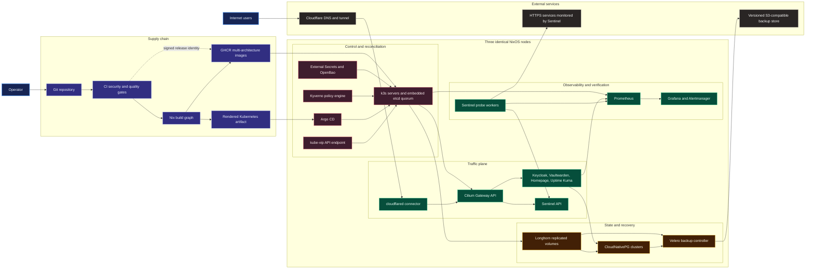
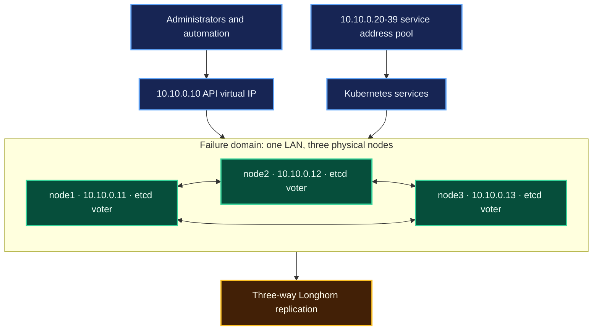

# Architecture

This is a three-node, highly available Kubernetes platform built from one
pinned Nix dependency graph and reconciled from one generated manifest. The
diagram distinguishes build-time supply chain, external trust boundaries,
cluster control, application traffic, state, and telemetry.

Solid arrows are runtime or reconciliation flows. The dotted arrow is the
release identity boundary: GitHub OIDC signs future workflow releases, while
the currently published bootstrap images are digest-pinned and explicitly
documented as manually published.

## Physical topology

The committed profile describes three identical PCs. Each is an
`x86_64-linux` k3s server with an Intel Core i7-8650U (4 cores / 8 threads),
32 GiB RAM, and a 512 GB SATA SSD. All nodes use the same verified controller
path and Intel wired interface name; only hostname and address differ.

The SATA path `/dev/disk/by-path/pci-0000:00:17.0-ata-3` and interface
`enp0s31f6` were observed on the reference PC. Because installation is
destructive, the installer must confirm the same model, size, controller path,
and interface on all three machines before partitioning.

## Ownership and trust boundaries

| Layer | Owner | Enforced contract |
| --- | --- | --- |
| Dependencies | `flake.lock` and fixed-output hashes | Evaluation performs no unpinned fetch |
| Hosts | NixOS and Disko modules | Same reviewed OS, disk, network, k3s, and firewall state on every node |
| Bootstrap | `scripts/bootstrap-cluster.sh` | CRDs establish before dependent custom resources |
| Desired cluster state | Argo CD | Reconciles only `rendered/all.yaml` from `main` |
| Workload artifacts | GHCR digests | Runtime never resolves a floating image tag |
| Secrets | Private SOPS module and External Secrets | Plaintext never enters Git or a Nix store path |
| Public edge | Cloudflare variables supplied at apply time | Account, zone, public domain, and credentials stay outside Git |
| Recovery | Longhorn, CNPG, Velero, and runbooks | Restore is accepted only after an environment-specific drill |

## Reconciliation and boot order

1. Nix builds identical host closures and a deterministic Kubernetes artifact.
2. Node 1 initializes embedded etcd; nodes 2 and 3 join through the kube-vip
   endpoint using one out-of-band k3s token.
3. Bootstrap establishes CRDs before applying namespaces, RBAC, storage,
   networking, controllers, and custom resources.
4. Argo CD adopts the same artifact and becomes its sole reconciler.
5. Kyverno rejects policy violations; integrity and schema gates reject
   unsupported APIs, duplicate identities, missing namespaces, and mutable
   workload images before merge.

## Availability limits

Three etcd voters tolerate one unavailable node. Application anti-affinity,
budgets, replicated volumes, and database instances reduce correlated
failures, but this is one power, network, and geographic domain. Two node
failures lose quorum. Backups outside the cluster are therefore part of the
availability design, not an optional extra.
